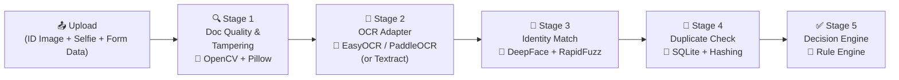

# PS-003 — Problem Statement Analysis
## AI-Powered Identity & Eligibility Verification for Hackathon Registrations

> [!NOTE]
> **Event**: AI Build Challenge — Bengaluru · 18 Sept 2026  
> **Industry Partner**: Hackingly  
> **Venue**: Startup Park, Koramangala

> [!IMPORTANT]
> **Resource Constraint**: All tools, models, and APIs must come from either the **organization (Hackingly)** — i.e., the existing AWS Textract pipeline — or from **open-source platforms**. No paid proprietary services (AWS Rekognition, Google Vision API, etc.) unless explicitly provided.

---

## 1. Problem Summary

Hackingly runs hackathon registrations that are often **age-restricted, student-only, or ID-gated**. They currently have a basic **AWS Textract OCR pipeline** that extracts a **date of birth** from an uploaded ID image to auto-check age eligibility. However, this pipeline has critical gaps:

| What Exists Today | What's Missing |
|---|---|
| OCR-based DOB extraction via AWS Textract | Fake / tampered document detection |
| Basic age eligibility check | Duplicate ID detection across registrations |
| — | Face matching (selfie vs. ID photo) |
| — | Multi-field extraction (name, ID number, institution) |
| — | Confidence scoring & human-readable decisions |
| — | Support for multiple Indian ID types |

---

## 2. Core Requirements (Must-Have)

These are explicitly stated requirements from the problem statement:

### 2.1 Extend the Existing Pipeline
- **Must build on top of AWS Textract**, not replace it
- Plug into Hackingly's existing registration flow with minimal changes

### 2.2 Multi-Field Extraction
- Extract from common Indian ID documents:
  - **Name**
  - **Date of Birth**
  - **ID Number / Type**
  - **Institution** (for college IDs)

### 2.3 Document Fraud Detection
- Flag **fake** documents
- Flag **tampered / edited** documents
- Flag **blurry** or low-quality documents
- Detect **duplicate IDs** — same ID reused across different registrations under different names

### 2.4 Identity Verification
- Cross-check extracted photo/name against registration form data
- **Face match** verification: selfie provided at registration vs. photo on the ID

### 2.5 Decision Output
- Return an **eligibility decision** per registration
- Include a **confidence score**
- Include a **human-readable reason** (e.g., "DOB indicates participant is 16; event requires 18+")

### 2.6 Low False Positives
> [!IMPORTANT]
> The problem statement **twice** emphasizes minimizing false positives. Legitimate participants must not be blocked by overly strict checks. This is a key evaluation criterion.

---

## 3. ID Types to Support

Based on the problem context (Indian hackathon registrations):

| Document | Key Fields | Notes |
|---|---|---|
| **Aadhaar Card** | Name, DOB, Aadhaar No., Photo | Most common; 12-digit number with checksum |
| **College / University ID** | Name, Roll No., Institution, Photo | Student-only event gating |
| **PAN Card** | Name, DOB, PAN No., Photo | 10-char alphanumeric, format: ABCDE1234F |
| **Government ID** (generic) | Name, DOB, ID No., Photo | Voter ID, Driving License, etc. |

---

## 4. Technical Architecture — Fully Open-Source Pipeline

> [!TIP]
> **Strategy**: Build everything on open-source now. Use a **pluggable OCR adapter** so AWS Textract can be swapped in at the venue with a one-line config change. This way you're never blocked waiting for credentials.

The solution decomposes into **5 pipeline stages**, all powered by open-source:



### Stage 1 — Document Quality & Tampering Detection (Fully Open-Source)
- **Blur detection**: OpenCV `cv2.Laplacian` variance — reject/flag images below threshold
- **Resolution check**: Minimum 300×400 px for readable OCR
- **Tampering detection**: Pillow-based Error Level Analysis (ELA) — resave as JPEG, diff against original to highlight edits
- **EXIF analysis**: Check for editing software signatures (Photoshop, GIMP metadata)
- **Document classification**: Simple CNN or template matching to identify Aadhaar vs. PAN vs. College ID

### Stage 2 — OCR / Field Extraction (Pluggable Adapter)

**This is the key architectural decision:**

```
┌──────────────────────────────────┐
│        OCR Adapter Interface     │
│   extract_text(image) → dict     │
├──────────┬───────────┬───────────┤
│ EasyOCR  │ PaddleOCR │ Textract  │
│ (default)│ (fallback)│ (plug-in) │
└──────────┴───────────┴───────────┘
```

- **Primary (for now)**: **EasyOCR** — supports English + Hindi, runs locally, no API keys
- **Fallback**: **PaddleOCR** — better on Indic scripts, use when EasyOCR confidence is low
- **Plug-in (at venue)**: **AWS Textract** — swap via config when credentials are provided
- **Post-processing** (same regardless of OCR engine):
  - Regex-based field extraction: name, DOB, ID number
  - Format validation: Aadhaar Verhoeff checksum, PAN format `ABCDE1234F`
  - Date normalization: handle DD/MM/YYYY, DD-MM-YYYY, Hindi date formats

### Stage 3 — Identity Verification (Fully Open-Source)
- **Face matching**: **DeepFace** (wrapping ArcFace model) — compare selfie embedding vs. ID photo embedding, return similarity score
- **Name matching**: **RapidFuzz** — Jaro-Winkler similarity between form name and OCR-extracted name
- **Transliteration**: **indic-transliteration** — handle Hindi↔English name variants before matching

### Stage 4 — Duplicate Detection (Fully Open-Source)
- **ID fingerprint**: Hash of (ID type + ID number) stored in SQLite
- **Cross-check**: Same ID number with different registrant name = flagged
- **Fuzzy duplicate**: Same name + similar DOB across different registrations = flagged

### Stage 5 — Eligibility Decision Engine (Fully Open-Source)
- Aggregate confidence scores from all stages into a weighted final score
- Apply event-specific rules (age ≥ 18, student-only, etc.)
- Three-tier output: `approved` / `manual_review` / `rejected`
- Output: `{ decision, confidence: 0.0–1.0, reason: "human-readable explanation", flags: [...] }`

---

## 5. AI/ML Components — Open-Source Stack

> [!NOTE]
> The **only** paid/proprietary service allowed is the **AWS Textract pipeline provided by Hackingly**. Everything else must be open-source.

### Organization-Provided Resources

| Resource | What It Gives You |
|---|---|
| **AWS Textract pipeline** | Raw OCR text extraction from ID images (existing, must build on top of) |
| **Anonymized sample ID images** | Test data (available on request from Hackingly) |

### Open-Source Tools & Models

| Component | Open-Source Tool | License | Purpose |
|---|---|---|---|
| **Face Detection** | [MTCNN](https://github.com/ipazc/mtcnn) | MIT | Detect and crop faces from ID photos and selfies |
| **Face Matching** | [DeepFace](https://github.com/serengil/deepface) (wraps ArcFace, FaceNet, etc.) | MIT | Selfie ↔ ID photo similarity scoring |
| **Face Matching (alt)** | [InsightFace](https://github.com/deepinsight/insightface) | Apache 2.0 | Higher accuracy face embeddings + comparison |
| **Liveness Detection** | [Silent-Face-Anti-Spoofing](https://github.com/minivision-ai/Silent-Face-Anti-Spoofing) | Apache 2.0 | Prevent photo-of-photo / screen replay attacks |
| **OCR (supplement Textract)** | [EasyOCR](https://github.com/JaidedAI/EasyOCR) | Apache 2.0 | Fallback OCR for Hindi text / poor Textract results |
| **OCR (alt)** | [PaddleOCR](https://github.com/PaddlePaddle/PaddleOCR) | Apache 2.0 | Multi-language OCR, strong on Indic scripts |
| **Tampering Detection** | [Pillow](https://github.com/python-pillow/Pillow) + custom ELA | BSD | Error Level Analysis to detect image edits |
| **Tampering Detection (CNN)** | [ImageForensics](https://github.com/minyoungg/selfconsistency) or custom CNN | MIT | Learned tampering classifiers |
| **Image Quality** | OpenCV (`cv2.Laplacian`) | Apache 2.0 | Blur / resolution / quality scoring |
| **Document Classification** | [YOLOv8](https://github.com/ultralytics/ultralytics) or fine-tuned ResNet | AGPL / MIT | Classify Aadhaar vs. PAN vs. College ID |
| **Name Matching** | [RapidFuzz](https://github.com/rapidfuzz/RapidFuzz) | MIT | Fuzzy string matching (Jaro-Winkler, Levenshtein) |
| **Transliteration** | [indic-transliteration](https://github.com/indic-transliteration/indic_transliteration_py) | MIT | Hindi ↔ English name transliteration |
| **Backend Framework** | [FastAPI](https://github.com/tiangolo/fastapi) | MIT | REST API for the verification pipeline |
| **Database** | [SQLite](https://sqlite.org/) / [PostgreSQL](https://www.postgresql.org/) | Public Domain / PostgreSQL License | Store ID hashes for duplicate detection |
| **Frontend (Dashboard)** | [React](https://react.dev/) or [Streamlit](https://streamlit.io/) | MIT / Apache 2.0 | Organizer dashboard for flagged registrations |

### Why These Choices?

- **DeepFace / InsightFace** replace AWS Rekognition — they run locally, no API costs, and achieve comparable accuracy on face verification
- **EasyOCR / PaddleOCR** supplement Textract for edge cases (Hindi text, low-quality scans)
- **RapidFuzz** handles the messy reality of Indian names (abbreviations, initials, transliteration variants)
- **OpenCV + Pillow** give us tampering detection without needing any paid forensics APIs

---

## 6. Evaluation Criteria Mapping

The judges will score on 5 axes. Here's how to map the solution:

| Criterion | How to Score Well |
|---|---|
| **Problem Understanding & Relevance** | Show you understand the real pain (manual verification doesn't scale, current OCR is too basic) |
| **Solution Quality & Problem-Solution Fit** | Cover ALL gaps: tampering, duplicates, face match, multi-field extraction — not just one |
| **Execution & Working Prototype** | Must be a **working demo**, not slides. End-to-end flow: upload → decision |
| **Innovation / Use of AI** | Go beyond basic OCR — tampering detection, face verification, confidence scoring |
| **Feasibility & Potential Impact** | Show it plugs into the existing Textract pipeline; quantify time saved vs. manual review |

> [!WARNING]
> **100% weightage on the final evaluation** — there is no separate ideation round. The prototype must work at the venue.

---

## 7. Strategic Observations

### What Will Differentiate a Winning Solution

1. **End-to-end working demo** — Judges want to see upload → verification → decision, not just one component
2. **Low false-positive design** — Build in a "manual review" bucket instead of hard rejecting borderline cases
3. **Graceful degradation** — If face match fails (no selfie), still return a decision with lower confidence rather than crashing
4. **Dashboard for organizers** — Show flagged registrations with reasons, not just API responses
5. **Beyond the basics** — Ideas the problem statement hints at with "think beyond":
   - Cross-event intelligence (flag serial impersonators across hackathons)
   - Liveness detection for selfies (prevent photo-of-photo attacks)
   - Multilingual name handling (Hindi ↔ English transliteration)

### Risks to Mitigate

| Risk | Mitigation |
|---|---|
| AWS Textract costs / latency | Cache results; batch processing |
| Poor quality uploads (blurry, dark) | Give real-time feedback to re-upload |
| Privacy concerns (biometric data) | Process in-memory, don't persist face embeddings, document your data handling |
| Over-engineering → incomplete prototype | Prioritize the happy path first, then add edge-case handling |

---

## 8. Build Priority (Recommended Order)

Given the "come 80% ready" instruction:

| Priority | Component | Pre-Event | At Venue |
|---|---|---|---|
| 🔴 P0 | AWS Textract integration + multi-field extraction | ✅ | Polish |
| 🔴 P0 | Eligibility decision engine with confidence scoring | ✅ | Polish |
| 🟠 P1 | Face matching (selfie vs. ID photo) | ✅ | Test |
| 🟠 P1 | Duplicate ID detection | ✅ | Test |
| 🟡 P2 | Tampering / fake document detection | Prototype | Complete |
| 🟡 P2 | Organizer dashboard UI | Wireframe | Build |
| 🟢 P3 | Liveness detection, cross-event intelligence | — | Demo if time |
