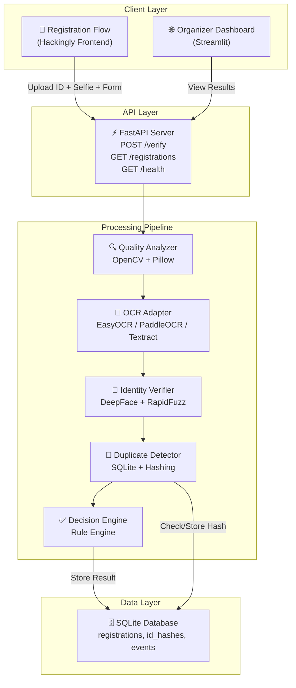
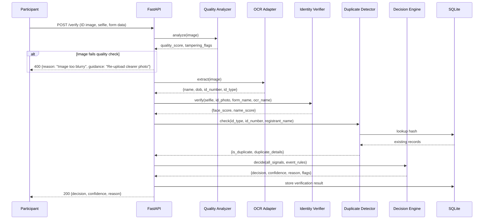

# Technical Design Document (TDD)
## VerifyAI — System Architecture & Technical Specification

| Field | Detail |
|---|---|
| **Version** | 1.0 |
| **Date** | 17 September 2026 |
| **Stack** | Python 3.11+ · FastAPI · SQLite · Open-Source ML |

---

## 1. System Architecture

### 1.1 High-Level Component Diagram



### 1.2 Request Flow (Single Verification)



---

## 2. Pipeline Stages — Detailed Design

### 2.1 Stage 1: Document Quality & Tampering Detection

**Module**: `pipeline/quality_analyzer.py`

| Check | Method | Threshold | Output |
|---|---|---|---|
| Blur detection | `cv2.Laplacian(gray, cv2.CV_64F).var()` | < 100 → blurry | `blur_score: float` |
| Resolution | `image.shape[0] * image.shape[1]` | < 120,000 px → too small | `resolution_ok: bool` |
| ELA tampering | Re-save at 90% JPEG, diff with original | Mean diff > 15 in any region → suspicious | `tampering_score: float, regions: list` |
| EXIF metadata | `PIL.ExifTags` — check for editing tools | Photoshop, GIMP, Snapseed → flag | `exif_flags: list` |
| Document type | Template matching / keyword detection | — | `doc_type: str` |

**Output Schema**:
```json
{
  "quality_passed": true,
  "blur_score": 245.7,
  "resolution_ok": true,
  "tampering_score": 0.12,
  "tampering_regions": [],
  "exif_flags": [],
  "detected_doc_type": "aadhaar",
  "quality_confidence": 0.94
}
```

### 2.2 Stage 2: OCR & Field Extraction

**Module**: `pipeline/ocr_adapter.py`

**Adapter Pattern**:
```python
class OCRAdapter(ABC):
    @abstractmethod
    def extract_raw(self, image: np.ndarray) -> list[dict]:
        """Return list of {text, confidence, bbox}"""
        pass

class EasyOCRAdapter(OCRAdapter): ...
class PaddleOCRAdapter(OCRAdapter): ...
class TextractAdapter(OCRAdapter): ...
```

**Field Extraction** (`pipeline/field_extractor.py`):

| Field | Extraction Method |
|---|---|
| Name | Positional heuristics per doc type + regex |
| DOB | Regex: `\d{2}[/-]\d{2}[/-]\d{4}` + date parsing |
| Aadhaar No. | Regex: `\d{4}\s?\d{4}\s?\d{4}` + Verhoeff checksum |
| PAN No. | Regex: `[A-Z]{5}\d{4}[A-Z]` |
| Institution | Keyword proximity ("University", "Institute", "College") |

**Output Schema**:
```json
{
  "name": "Arjun Kumar",
  "date_of_birth": "1998-05-14",
  "id_number": "1234 5678 9012",
  "id_type": "aadhaar",
  "institution": null,
  "extraction_confidence": 0.87,
  "raw_text": "...",
  "validation": {
    "id_format_valid": true,
    "checksum_valid": true
  }
}
```

### 2.3 Stage 3: Identity Verification

**Module**: `pipeline/identity_verifier.py`

**Face Matching**:
- Library: DeepFace with ArcFace backbone
- Process: Extract face from ID image → extract face from selfie → compute cosine similarity of embeddings
- Threshold: similarity > 0.60 → match, 0.40–0.60 → uncertain, < 0.40 → mismatch

**Name Matching**:
- Library: RapidFuzz
- Methods: Jaro-Winkler (primary), token sort ratio (for reordered names)
- Threshold: score > 85 → match, 60–85 → uncertain, < 60 → mismatch
- Pre-processing: lowercase, strip titles (Mr/Ms/Dr), normalize whitespace

**Output Schema**:
```json
{
  "face_match": {
    "score": 0.82,
    "verdict": "match",
    "selfie_provided": true
  },
  "name_match": {
    "score": 91.3,
    "verdict": "match",
    "form_name": "Arjun Kumar",
    "extracted_name": "ARJUN KUMAR"
  }
}
```

### 2.4 Stage 4: Duplicate Detection

**Module**: `pipeline/duplicate_detector.py`

**Strategy**:
1. Create fingerprint: `SHA256(id_type + normalized_id_number)`
2. Query SQLite `id_hashes` table
3. If hash exists with different registrant → flag duplicate

**Output Schema**:
```json
{
  "is_duplicate": false,
  "duplicate_registrations": [],
  "hash": "a1b2c3..."
}
```

### 2.5 Stage 5: Decision Engine

**Module**: `pipeline/decision_engine.py`

**Scoring Formula**:
```
final_score = (
    w1 * quality_confidence +
    w2 * extraction_confidence +
    w3 * face_match_score +
    w4 * name_match_score / 100 +
    w5 * (1.0 if not is_duplicate else 0.0)
)

Default weights: w1=0.10, w2=0.20, w3=0.30, w4=0.25, w5=0.15
```

**Decision Rules**:
| Condition | Decision |
|---|---|
| `final_score ≥ 0.75` AND no critical flags AND eligibility rules pass | `approved` |
| `final_score ≥ 0.50` OR has non-critical warnings | `manual_review` |
| `final_score < 0.50` OR has critical flags (duplicate, tampering) | `rejected` |
| Age below event minimum | `rejected` (reason: age) |
| Not a student for student-only event | `rejected` (reason: eligibility) |

**Output Schema**:
```json
{
  "decision": "approved",
  "confidence": 0.87,
  "reason": "All checks passed. Identity verified with high confidence.",
  "flags": [],
  "breakdown": {
    "quality": 0.94,
    "ocr": 0.87,
    "face_match": 0.82,
    "name_match": 0.91,
    "duplicate": 1.0
  },
  "eligibility": {
    "age_check": "pass",
    "student_check": "not_required"
  }
}
```

---

## 3. Data Models

### 3.1 Database Schema (SQLite)

```sql
-- Events table
CREATE TABLE events (
    id TEXT PRIMARY KEY,
    name TEXT NOT NULL,
    min_age INTEGER,
    max_age INTEGER,
    student_only BOOLEAN DEFAULT FALSE,
    allowed_id_types TEXT, -- JSON array
    created_at TIMESTAMP DEFAULT CURRENT_TIMESTAMP
);

-- Registrations table
CREATE TABLE registrations (
    id TEXT PRIMARY KEY,
    event_id TEXT REFERENCES events(id),
    form_name TEXT NOT NULL,
    form_email TEXT,
    form_dob TEXT,
    selfie_path TEXT,
    id_image_path TEXT,
    created_at TIMESTAMP DEFAULT CURRENT_TIMESTAMP
);

-- Verification results table
CREATE TABLE verifications (
    id TEXT PRIMARY KEY,
    registration_id TEXT REFERENCES registrations(id),
    decision TEXT CHECK(decision IN ('approved', 'manual_review', 'rejected')),
    confidence REAL,
    reason TEXT,
    flags TEXT, -- JSON array
    breakdown TEXT, -- JSON object
    extracted_name TEXT,
    extracted_dob TEXT,
    extracted_id_number TEXT,
    extracted_id_type TEXT,
    face_match_score REAL,
    name_match_score REAL,
    quality_score REAL,
    tampering_score REAL,
    is_duplicate BOOLEAN DEFAULT FALSE,
    processed_at TIMESTAMP DEFAULT CURRENT_TIMESTAMP
);

-- ID hash registry for duplicate detection
CREATE TABLE id_hashes (
    hash TEXT PRIMARY KEY,
    id_type TEXT,
    id_number_masked TEXT, -- Last 4 digits only
    registrant_name TEXT,
    registration_id TEXT REFERENCES registrations(id),
    event_id TEXT REFERENCES events(id),
    created_at TIMESTAMP DEFAULT CURRENT_TIMESTAMP
);
```

---

## 4. Technology Stack

| Layer | Technology | Version | Purpose |
|---|---|---|---|
| Language | Python | 3.11+ | Core runtime |
| API Framework | FastAPI | 0.100+ | REST API server |
| ASGI Server | Uvicorn | 0.23+ | Async server |
| OCR (primary) | EasyOCR | 1.7+ | Text extraction |
| OCR (fallback) | PaddleOCR | 2.7+ | Indic script fallback |
| Face Detection | MTCNN | 0.1+ | Face crop from images |
| Face Matching | DeepFace | 0.0.80+ | Face embedding comparison |
| Name Matching | RapidFuzz | 3.0+ | Fuzzy string matching |
| Image Processing | OpenCV | 4.8+ | Quality & blur detection |
| Image Processing | Pillow | 10.0+ | ELA tampering detection |
| Database | SQLite | 3.40+ | Data persistence |
| Dashboard | Streamlit | 1.28+ | Organizer UI |
| Testing | pytest | 7.0+ | Unit & integration tests |

---

## 5. Project Structure

```
verifyai/
├── app/
│   ├── main.py                  # FastAPI app entry point
│   ├── config.py                # Configuration management
│   ├── models.py                # Pydantic request/response models
│   ├── database.py              # SQLite connection & setup
│   └── routes/
│       ├── verify.py            # POST /verify endpoint
│       ├── registrations.py     # GET /registrations endpoints
│       └── health.py            # GET /health endpoint
├── pipeline/
│   ├── __init__.py
│   ├── orchestrator.py          # Runs all stages in sequence
│   ├── quality_analyzer.py      # Stage 1: Quality & tampering
│   ├── ocr_adapter.py           # Stage 2: Pluggable OCR
│   ├── field_extractor.py       # Stage 2: Parse structured fields
│   ├── identity_verifier.py     # Stage 3: Face + name matching
│   ├── duplicate_detector.py    # Stage 4: Duplicate check
│   └── decision_engine.py       # Stage 5: Final decision
├── dashboard/
│   └── app.py                   # Streamlit organizer dashboard
├── tests/
│   ├── test_quality.py
│   ├── test_ocr.py
│   ├── test_identity.py
│   ├── test_duplicates.py
│   └── test_decision.py
├── data/
│   └── samples/                 # Anonymized test images
├── requirements.txt
├── config.yaml                  # Runtime configuration
└── README.md
```

---

## 6. Configuration

**`config.yaml`**:
```yaml
ocr:
  engine: "easyocr"          # easyocr | paddleocr | textract
  languages: ["en", "hi"]
  confidence_threshold: 0.5

quality:
  blur_threshold: 100
  min_resolution: [300, 400]
  ela_threshold: 15

face_match:
  model: "ArcFace"
  backend: "opencv"
  threshold_match: 0.60
  threshold_uncertain: 0.40

name_match:
  method: "jaro_winkler"
  threshold_match: 85
  threshold_uncertain: 60

decision:
  weights:
    quality: 0.10
    ocr: 0.20
    face: 0.30
    name: 0.25
    duplicate: 0.15
  approve_threshold: 0.75
  review_threshold: 0.50

database:
  path: "data/verifyai.db"

server:
  host: "0.0.0.0"
  port: 8000
```

---

## 7. Error Handling

| Scenario | Response Code | Behavior |
|---|---|---|
| No face detected in ID image | 200 | Return decision with `face_match: null`, lower confidence |
| No face detected in selfie | 200 | Skip face match, note in flags, lower confidence |
| OCR returns no text | 200 | Return `rejected` with reason "Could not extract text from document" |
| Image format unsupported | 400 | Return error with supported formats |
| File too large (>10MB) | 413 | Return error with size limit |
| Internal pipeline error | 500 | Log error, return "manual_review" with reason "Verification system error" |

**Design Principle**: Never crash. Always return a decision. If uncertain, route to `manual_review`.

---

## 8. Security & Privacy

| Concern | Mitigation |
|---|---|
| Face embeddings | Computed in-memory, never persisted to disk or database |
| ID images | Stored temporarily for demo; production would process in-memory only |
| ID numbers | Only last 4 digits stored in `id_hashes` table (`id_number_masked`) |
| API access | API key authentication for production (demo: open) |
| Data at rest | SQLite file; production would use encrypted storage |

---

## 9. Performance Targets

| Operation | Target Latency | Notes |
|---|---|---|
| Quality analysis | < 500ms | OpenCV operations are fast |
| OCR extraction | < 3s | EasyOCR on CPU; GPU would be faster |
| Face matching | < 2s | DeepFace ArcFace on CPU |
| Name matching | < 50ms | RapidFuzz is C-optimized |
| Duplicate check | < 50ms | SQLite hash lookup |
| Decision engine | < 10ms | Pure computation |
| **Total pipeline** | **< 8s** | **End-to-end target** |
