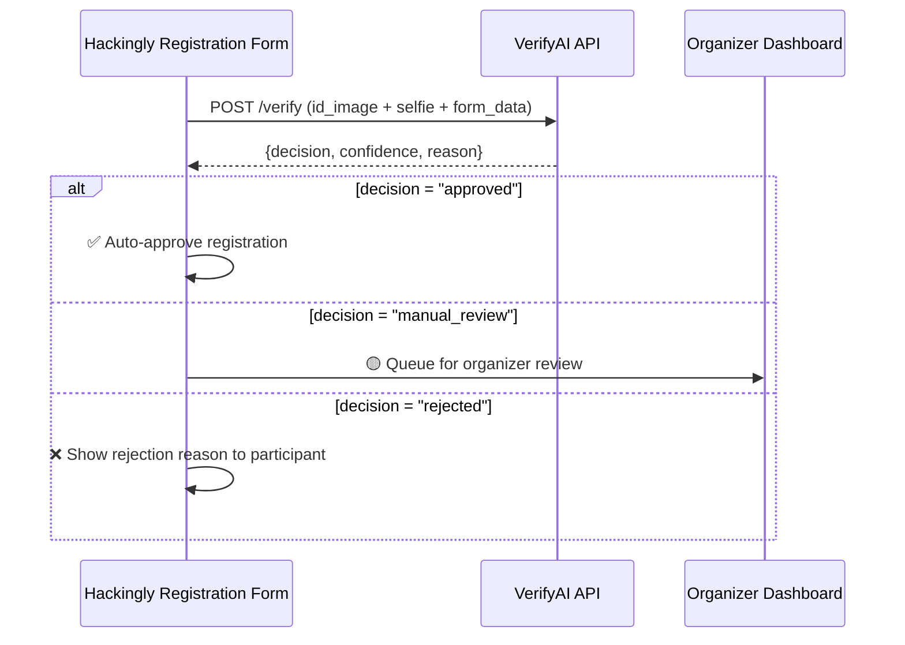

# API Specification
## VerifyAI — REST API Reference

| Field | Detail |
|---|---|
| **Base URL** | `http://localhost:8000/api/v1` |
| **Format** | JSON (responses), Multipart Form Data (uploads) |
| **Auth** | None (demo) / API Key header (production) |

---

## Endpoints Overview

| Method | Endpoint | Description |
|---|---|---|
| `POST` | `/verify` | Submit an ID image + selfie for verification |
| `GET` | `/registrations` | List all registrations with verification results |
| `GET` | `/registrations/{id}` | Get detailed verification result for one registration |
| `POST` | `/events` | Create/configure an event with eligibility rules |
| `GET` | `/health` | Health check |

---

## 1. `POST /verify` — Verify a Registration

Submit an ID document image, optional selfie, and registration form data for verification.

### Request

**Content-Type**: `multipart/form-data`

| Field | Type | Required | Description |
|---|---|---|---|
| `id_image` | File (JPEG/PNG/WebP) | ✅ | Photo of the ID document |
| `selfie` | File (JPEG/PNG/WebP) | ❌ | Selfie photo of the registrant |
| `form_name` | String | ✅ | Name as entered in registration form |
| `form_email` | String | ❌ | Email from registration form |
| `form_dob` | String (YYYY-MM-DD) | ❌ | DOB from registration form |
| `event_id` | String | ✅ | Event ID to check eligibility against |

### Example Request
```bash
curl -X POST http://localhost:8000/api/v1/verify \
  -F "id_image=@aadhaar_front.jpg" \
  -F "selfie=@selfie.jpg" \
  -F "form_name=Arjun Kumar" \
  -F "form_email=arjun@email.com" \
  -F "form_dob=1998-05-14" \
  -F "event_id=hackathon-2026"
```

### Success Response — `200 OK`
```json
{
  "registration_id": "reg_a1b2c3d4",
  "decision": "approved",
  "confidence": 0.87,
  "reason": "All checks passed. Identity verified with high confidence.",
  "flags": [],
  "breakdown": {
    "quality": {
      "score": 0.94,
      "blur_score": 245.7,
      "tampering_score": 0.05,
      "resolution_ok": true,
      "detected_doc_type": "aadhaar"
    },
    "extraction": {
      "score": 0.87,
      "name": "ARJUN KUMAR",
      "date_of_birth": "1998-05-14",
      "id_number_masked": "****9012",
      "id_type": "aadhaar",
      "format_valid": true
    },
    "identity": {
      "face_match_score": 0.82,
      "face_match_verdict": "match",
      "name_match_score": 91.3,
      "name_match_verdict": "match"
    },
    "duplicate": {
      "is_duplicate": false,
      "previous_registrations": []
    },
    "eligibility": {
      "age_check": "pass",
      "computed_age": 28,
      "student_check": "not_required"
    }
  },
  "processing_time_ms": 4523
}
```

### Partial Success — `200 OK` (Manual Review)
```json
{
  "registration_id": "reg_e5f6g7h8",
  "decision": "manual_review",
  "confidence": 0.58,
  "reason": "Face match uncertain. Name partially matches. Routed for manual review.",
  "flags": [
    "face_match_uncertain",
    "name_partial_match"
  ],
  "breakdown": { "..." },
  "processing_time_ms": 5102
}
```

### Rejection — `200 OK` (Rejected)
```json
{
  "registration_id": "reg_i9j0k1l2",
  "decision": "rejected",
  "confidence": 0.22,
  "reason": "Duplicate ID detected. This Aadhaar number was previously used by a different registrant.",
  "flags": [
    "duplicate_id",
    "name_mismatch"
  ],
  "breakdown": { "..." },
  "processing_time_ms": 3891
}
```

### Error Responses

| Code | Scenario | Body |
|---|---|---|
| `400` | Missing required fields | `{"error": "id_image is required"}` |
| `400` | Unsupported file format | `{"error": "Unsupported format. Use JPEG, PNG, or WebP"}` |
| `400` | Image too blurry | `{"error": "Image too blurry", "guidance": "Please upload a clearer photo"}` |
| `404` | Event not found | `{"error": "Event 'xyz' not found"}` |
| `413` | File too large | `{"error": "File exceeds 10MB limit"}` |
| `500` | Internal error | `{"error": "Verification failed", "decision": "manual_review"}` |

---

## 2. `GET /registrations` — List Registrations

### Query Parameters

| Param | Type | Default | Description |
|---|---|---|---|
| `event_id` | String | — | Filter by event |
| `status` | String | all | Filter: `approved`, `manual_review`, `rejected` |
| `page` | Integer | 1 | Pagination |
| `limit` | Integer | 50 | Results per page |

### Example Request
```bash
curl "http://localhost:8000/api/v1/registrations?event_id=hackathon-2026&status=manual_review"
```

### Response — `200 OK`
```json
{
  "total": 23,
  "page": 1,
  "limit": 50,
  "registrations": [
    {
      "registration_id": "reg_e5f6g7h8",
      "form_name": "Priya Sharma",
      "decision": "manual_review",
      "confidence": 0.58,
      "reason": "Face match uncertain.",
      "flags": ["face_match_uncertain"],
      "processed_at": "2026-09-18T10:15:30Z"
    }
  ]
}
```

---

## 3. `GET /registrations/{id}` — Get Verification Detail

### Example Request
```bash
curl "http://localhost:8000/api/v1/registrations/reg_e5f6g7h8"
```

### Response — `200 OK`
Returns the full verification result (same schema as `POST /verify` response).

---

## 4. `POST /events` — Create Event with Rules

### Request Body (`application/json`)
```json
{
  "id": "hackathon-2026",
  "name": "AI Build Challenge Bengaluru 2026",
  "rules": {
    "min_age": 18,
    "max_age": null,
    "student_only": false,
    "allowed_id_types": ["aadhaar", "pan", "college_id", "voter_id"]
  }
}
```

### Response — `201 Created`
```json
{
  "id": "hackathon-2026",
  "name": "AI Build Challenge Bengaluru 2026",
  "rules": { "..." },
  "created_at": "2026-09-17T21:00:00Z"
}
```

---

## 5. `GET /health` — Health Check

### Response — `200 OK`
```json
{
  "status": "healthy",
  "version": "1.0.0",
  "ocr_engine": "easyocr",
  "models_loaded": true,
  "database": "connected",
  "uptime_seconds": 3600
}
```

---

## Integration Guide for Hackingly

### Minimal Integration (3 Steps)



1. **On form submit**: Send ID image, selfie, and form data to `POST /verify`
2. **Handle response**: Auto-approve, queue for review, or reject based on `decision`
3. **Organizer review**: Use dashboard or `GET /registrations?status=manual_review`
