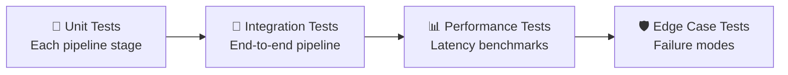

# Testing Strategy
## VerifyAI — Test Plan & Verification

| Field | Detail |
|---|---|
| **Version** | 1.0 |
| **Framework** | pytest |
| **Coverage Target** | Core pipeline stages |

---

## 1. Test Categories

---

## 2. Unit Tests — Per Stage

### 2.1 Quality Analyzer (`test_quality.py`)

| Test | Input | Expected Output |
|---|---|---|
| `test_clear_image_passes` | High-quality ID scan | `quality_passed: true`, `blur_score > 100` |
| `test_blurry_image_flagged` | Intentionally blurred image | `quality_passed: false`, `blur_score < 100` |
| `test_low_resolution_flagged` | 100×150 px image | `resolution_ok: false` |
| `test_tampered_image_detected` | Photoshopped ID (modified DOB) | `tampering_score > 0.15` |
| `test_clean_image_no_tampering` | Unedited original scan | `tampering_score < 0.10` |
| `test_exif_editing_software` | Image with Photoshop EXIF data | `exif_flags: ["Adobe Photoshop"]` |
| `test_no_exif_passes` | Image with no EXIF | `exif_flags: []` |

### 2.2 OCR Adapter (`test_ocr.py`)

| Test | Input | Expected Output |
|---|---|---|
| `test_easyocr_extracts_text` | Clear Aadhaar image | Non-empty text with Aadhaar number |
| `test_adapter_swap_to_paddleocr` | Config: `engine=paddleocr` | PaddleOCR backend used |
| `test_adapter_interface_consistency` | Same image, both engines | Both return `{text, confidence, bbox}` format |

### 2.3 Field Extractor (`test_field_extractor.py`)

| Test | Input | Expected Output |
|---|---|---|
| `test_aadhaar_number_extraction` | Text containing `1234 5678 9012` | `id_number: "1234 5678 9012"` |
| `test_pan_number_extraction` | Text containing `ABCDE1234F` | `id_number: "ABCDE1234F"` |
| `test_dob_extraction_slash` | Text containing `14/05/1998` | `dob: "1998-05-14"` |
| `test_dob_extraction_dash` | Text containing `14-05-1998` | `dob: "1998-05-14"` |
| `test_aadhaar_checksum_valid` | Valid Aadhaar number | `checksum_valid: true` |
| `test_aadhaar_checksum_invalid` | Modified Aadhaar number | `checksum_valid: false` |
| `test_pan_format_valid` | `ABCDE1234F` | `format_valid: true` |
| `test_pan_format_invalid` | `12345ABCDE` | `format_valid: false` |
| `test_name_extraction` | Aadhaar OCR text | Non-empty name string |

### 2.4 Identity Verifier (`test_identity.py`)

| Test | Input | Expected Output |
|---|---|---|
| `test_same_person_face_match` | Selfie + ID of same person | `face_score > 0.60` |
| `test_different_person_face_mismatch` | Selfie of person A + ID of person B | `face_score < 0.40` |
| `test_no_selfie_graceful` | ID image only, no selfie | `face_match: null`, no crash |
| `test_no_face_in_id` | ID image with no detectable face | `face_match: null`, flag added |
| `test_name_exact_match` | Form: "Arjun Kumar", OCR: "ARJUN KUMAR" | `name_score > 90` |
| `test_name_partial_match` | Form: "Arjun K", OCR: "ARJUN KUMAR" | `name_score: 60–85` |
| `test_name_mismatch` | Form: "Priya Sharma", OCR: "ARJUN KUMAR" | `name_score < 60` |

### 2.5 Duplicate Detector (`test_duplicates.py`)

| Test | Input | Expected Output |
|---|---|---|
| `test_first_submission_no_duplicate` | New ID number | `is_duplicate: false` |
| `test_same_id_same_name_ok` | Same ID + same name (re-registration) | `is_duplicate: false` or soft flag |
| `test_same_id_different_name_flagged` | Same ID + different name | `is_duplicate: true` |
| `test_different_id_no_duplicate` | Different ID number | `is_duplicate: false` |

### 2.6 Decision Engine (`test_decision.py`)

| Test | Input | Expected Output |
|---|---|---|
| `test_all_pass_approved` | All scores high, no flags | `decision: "approved"` |
| `test_low_face_match_review` | Face score 0.50, rest high | `decision: "manual_review"` |
| `test_duplicate_rejected` | `is_duplicate: true` | `decision: "rejected"` |
| `test_underage_rejected` | DOB → age 16, event min_age 18 | `decision: "rejected"`, reason contains "age" |
| `test_reason_is_human_readable` | Any input | `reason` is a non-empty English sentence |
| `test_confidence_in_range` | Any input | `0.0 ≤ confidence ≤ 1.0` |

---

## 3. Integration Tests

### 3.1 End-to-End Pipeline (`test_e2e.py`)

| Test | Description |
|---|---|
| `test_happy_path_aadhaar` | Upload valid Aadhaar + matching selfie + correct form → `approved` |
| `test_happy_path_pan` | Upload valid PAN + matching selfie + correct form → `approved` |
| `test_tampered_doc_rejected` | Upload edited Aadhaar → `rejected` with tampering flag |
| `test_duplicate_id_rejected` | Submit same Aadhaar under different name → `rejected` with duplicate flag |
| `test_no_selfie_lower_confidence` | Upload Aadhaar without selfie → `approved` or `manual_review`, lower confidence |
| `test_blurry_upload_error` | Upload blurry image → `400` with guidance message |
| `test_wrong_format_error` | Upload PDF instead of image → `400` with format error |

### 3.2 API Integration (`test_api.py`)

| Test | Description |
|---|---|
| `test_post_verify_returns_200` | Valid multipart request → 200 |
| `test_post_verify_missing_image_400` | No id_image → 400 |
| `test_get_registrations_returns_list` | GET after verification → list with results |
| `test_get_registration_by_id` | GET specific registration → full detail |
| `test_post_event_creates_event` | Create event with rules → 201 |
| `test_health_check` | GET /health → 200 with status "healthy" |

---

## 4. Test Data Requirements

| Data Type | Quantity | Source | Notes |
|---|---|---|---|
| Valid Aadhaar images | 5–10 | Anonymized samples from Hackingly | Or generated test images |
| Valid PAN images | 3–5 | Anonymized samples | |
| Valid College IDs | 3–5 | Anonymized samples | |
| Tampered documents | 3–5 | Self-created (edit DOB/name in image editor) | For tampering detection tests |
| Blurry images | 3 | Gaussian blur applied to valid images | |
| Selfie-ID pairs (match) | 5 | Team members or stock photos | |
| Selfie-ID pairs (mismatch) | 5 | Mix-matched pairs | |
| Duplicate scenario data | 2 sets | Same ID image with different form names | |

---

## 5. Edge Cases to Test

| Edge Case | Expected Behavior |
|---|---|
| Image is completely black | `rejected`: "Could not extract text from document" |
| Image is a screenshot of an ID (not a photo) | Lower quality score, may flag EXIF |
| Name in Hindi on ID, English in form | Transliteration-aware matching (P2 feature) |
| Very old DOB (age > 100) | Flag as suspicious but don't hard reject |
| Multiple faces detected in ID | Use the largest / most prominent face |
| ID image is rotated 90° | Auto-rotate before processing |
| Same person registers twice for same event | Allow (not a duplicate abuse case) |
| Network timeout during OCR | Return "manual_review" with error reason |

---

## 6. Performance Benchmarks

| Metric | Target | How to Test |
|---|---|---|
| Single verification latency | < 8 seconds | `time` the `/verify` endpoint |
| Concurrent verifications (10) | < 15 seconds each | `locust` or `ab` load test |
| OCR accuracy | > 90% | Compare extracted fields against labeled ground truth |
| Face match accuracy | > 95% | Test against known match/mismatch pairs |
| False positive rate | < 2% | Run against set of 50 valid IDs |

---

## 7. Pre-Venue Checklist

- [ ] All unit tests pass
- [ ] End-to-end happy path works with sample Aadhaar
- [ ] End-to-end happy path works with sample PAN
- [ ] Duplicate detection works across two registrations
- [ ] Face match returns reasonable scores for same/different person
- [ ] Decision engine returns human-readable reasons
- [ ] API responds within 10 seconds
- [ ] Dashboard displays verification results
- [ ] Error handling: blurry image returns guidance
- [ ] Error handling: missing fields return clear error
