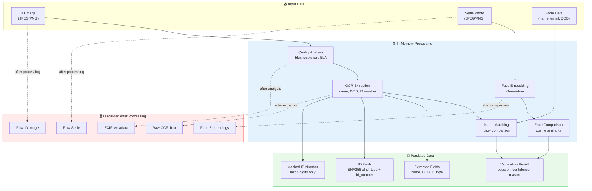

# Data Flow & Privacy Document
## VerifyAI — Data Lifecycle & Privacy Safeguards

---

## 1. Data Flow Diagram



---

## 2. Data Classification

| Data Element | Classification | Collected | Persisted | Retention |
|---|---|---|---|---|
| ID Image (raw) | **Sensitive PII** | ✅ | ❌ (demo: temp file) | Deleted after processing |
| Selfie Image (raw) | **Sensitive Biometric** | ✅ | ❌ | Deleted after processing |
| Face Embeddings | **Sensitive Biometric** | Generated | ❌ | In-memory only, discarded |
| Full ID Number | **Sensitive PII** | Extracted | ❌ | Only hash + last 4 digits stored |
| ID Number Hash | **Pseudonymized** | Generated | ✅ | Duration of event |
| Masked ID Number | **Reduced PII** | Generated | ✅ | Duration of event |
| Extracted Name | **PII** | Extracted | ✅ | Duration of event |
| Extracted DOB | **PII** | Extracted | ✅ | Duration of event |
| Form Name | **PII** | Submitted | ✅ | Duration of event |
| Form Email | **PII** | Submitted | ✅ | Duration of event |
| Verification Decision | **Non-PII** | Generated | ✅ | Duration of event |
| Confidence Score | **Non-PII** | Generated | ✅ | Duration of event |
| EXIF Metadata | **Metadata** | Extracted | ❌ | Discarded after analysis |

---

## 3. Processing Pipeline — Data at Each Stage

### Stage 1: Quality Analysis
```
IN:  Raw ID image (bytes)
USE: OpenCV (blur), Pillow (ELA), EXIF parser
OUT: quality_score, tampering_score, exif_flags
     → Images NOT stored. Scores persisted.
```

### Stage 2: OCR Extraction
```
IN:  Raw ID image (bytes)
USE: EasyOCR / PaddleOCR / Textract
OUT: Extracted text → parsed into name, DOB, ID number
     → Raw OCR text discarded. Structured fields persisted.
     → Full ID number hashed. Only hash + last 4 digits persisted.
```

### Stage 3: Face Matching
```
IN:  Raw selfie (bytes), face region from ID image
USE: DeepFace (ArcFace model)
OUT: Face embeddings → cosine similarity score
     → Embeddings computed in memory, NEVER written to disk.
     → Only the similarity score (float) is persisted.
```

### Stage 4: Duplicate Detection
```
IN:  ID hash, registrant name
USE: SQLite lookup
OUT: is_duplicate, previous registrations
     → Hash compared against stored hashes.
```

### Stage 5: Decision Engine
```
IN:  All scores + event rules
USE: Weighted formula + rule checks
OUT: decision, confidence, reason, flags
     → All persisted for organizer review.
```

---

## 4. Privacy Safeguards

| Safeguard | Implementation |
|---|---|
| **No biometric storage** | Face embeddings are computed in-memory and discarded after comparison. They are never serialized, logged, or written to any database. |
| **ID number masking** | Full ID numbers are never stored. Only a one-way SHA-256 hash (for duplicate detection) and the last 4 digits (for display) are persisted. |
| **Image disposal** | Raw ID images and selfies are processed in-memory. In the demo, temporary files are deleted after pipeline completion. In production, they would never touch disk. |
| **EXIF stripping** | EXIF metadata is read for tampering analysis, then discarded. It is not stored or forwarded. |
| **Minimal data retention** | Only the verification result and minimal identifying fields are retained. No raw documents. |
| **No third-party data sharing** | All processing is local. No images or biometric data are sent to external APIs (except Textract for OCR, which is org-provided). |

---

## 5. Data Retention Policy

| Data | Demo (Hackathon) | Production (Recommended) |
|---|---|---|
| Raw images | Deleted after processing | Never written to disk |
| Face embeddings | In-memory only | In-memory only |
| Verification results | SQLite, persisted for demo | Encrypted DB, 90-day retention |
| ID hashes | SQLite, persisted for demo | Encrypted DB, per-event lifecycle |
| Form data | SQLite, persisted for demo | Encrypted DB, user-deletable (GDPR) |

---

## 6. Summary — What We Store vs. What We Don't

```
✅ STORED                          ❌ NOT STORED
─────────────────                  ─────────────────
• Decision (approved/rejected)     • Raw ID images
• Confidence score                 • Raw selfie photos
• Human-readable reason            • Face embeddings
• Extracted name, DOB              • Full ID numbers
• ID type                          • EXIF metadata
• ID hash (SHA-256)                • Raw OCR text
• Last 4 digits of ID number
• Match scores (face, name)
• Flags and warnings
```
