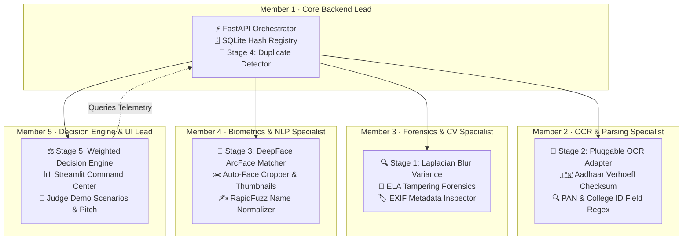

# 🛡️ VerifyAI — Team Workload & Execution Plan
### AI Build Challenge Bengaluru · PS-003 Hackingly Track

> [!NOTE]
> **Mission**: Build an AI-powered identity and eligibility verification platform that catches fake/tampered IDs, prevents duplicate ID reuse, and verifies identity via biometrics with < 2% false positives.
>
> **Target**: Arrive at the venue **80% built** and demo-ready with end-to-end verification.

---

## 👥 5-Member Team Allocation Architecture



---

## 🎯 Modular Track Breakdown

| Role / Track | Member Focus | Key Source Files | Delivered Capabilities |
|---|---|---|---|
| **Member 1**<br/>`Backend Lead` | Architecture & Duplicate Fraud | `app/main.py`<br/>`app/database.py`<br/>`pipeline/orchestrator.py`<br/>`pipeline/duplicate_detector.py` | • FastAPI server (`POST /verify`, `GET /registrations`)<br/>• SQLite schema (`events`, `verifications`, `id_hashes`)<br/>• SHA-256 fingerprinting for duplicate ID prevention |
| **Member 2**<br/>`OCR Specialist` | Document Parsing & Checksums | `pipeline/ocr_adapter.py`<br/>`pipeline/field_extractor.py`<br/>`tests/test_ocr.py` | • Pluggable OCR (`EasyOCR`, `Textract`, `Mock`)<br/>• **Aadhaar Verhoeff checksum algorithm**<br/>• PAN format validation (`[A-Z]{5}[0-9]{4}[A-Z]`)<br/>• Student College ID & roll number parsing |
| **Member 3**<br/>`CV Specialist` | Image Quality & Tampering | `pipeline/quality_analyzer.py`<br/>`tests/test_quality.py` | • Laplacian variance blur detector (< 100 threshold)<br/>• Glare & overexposure checking<br/>• **Error Level Analysis (ELA)** generating visual heatmaps<br/>• EXIF inspection for Photoshop / Canva signatures |
| **Member 4**<br/>`Biometrics Specialist` | Facial & Name Matching | `pipeline/identity_verifier.py`<br/>`tests/test_identity.py` | • Facial embedding comparison with **DeepFace (ArcFace)**<br/>• Auto-crop face badge thumbnails from ID & selfie<br/>• **RapidFuzz** token sort ratio for Indian names |
| **Member 5**<br/>`Fullstack & Pitch Lead` | Decision Engine & Dashboard | `pipeline/decision_engine.py`<br/>`dashboard/app.py`<br/>`run.py` | • Multi-signal weighted scoring (0.0 to 1.0)<br/>• 3-tier verdict (`approved`, `manual_review`, `rejected`)<br/>• Plain-English explanations minimizing false positives<br/>• **Streamlit Command Center UI** with 1-click demo presets |

---

## 🔗 Clean Python Interfaces (Zero Bottlenecks)

Each module communicates through standard dictionaries:

```python
# Member 3: Quality & Forensics
quality_res = check_quality_and_tampering(id_image_path)
# -> {"quality_passed": bool, "blur_score": float, "tampering_score": float, "ela_heatmap_base64": str}

# Member 2: OCR & Extraction
ocr_res = extract_id_fields(raw_text_blocks)
# -> {"name": str, "dob": str, "id_number": str, "id_type": str, "checksum_valid": bool}

# Member 4: Biometrics & Name Match
identity_res = verify_identity(id_image_path, selfie_path, form_name, ocr_res["name"])
# -> {"face_match": {"score": float, "verdict": str}, "name_match": {"score": float}}

# Member 1: Duplicate ID Abuse Check
duplicate_res = check_duplicate(id_type, id_number, form_name, registration_id)
# -> {"is_duplicate": bool, "flags": list, "details": str}

# Member 5: Decision Engine
decision_res = evaluate_eligibility(quality_res, ocr_res, identity_res, duplicate_res, event_rules)
# -> {"decision": "approved"|"manual_review"|"rejected", "confidence": float, "reason": str}
```

---

## 🏆 Presentation Script for Hackathon Judges

When presenting to the judges at the AI Build Challenge:

1. **The Hook (30 sec)**:
   > *"Hackingly's current pipeline only checks age via Textract OCR. Anyone can submit a photoshopped Aadhaar, reuse someone else's ID, or register under a false name. We built VerifyAI to transform that into an autonomous, tamper-proof verification engine."*

2. **The Live Demo (90 sec)**:
   - **Click Preset 1 (Genuine Aadhaar):** Show auto-approval in < 900ms with high confidence.
   - **Click Preset 2 (Duplicate Fraud):** Show how Vikram Singh reusing Arjun's Aadhaar triggers an instant fraud rejection with hash audit trail.
   - **Show Forensic Visuals:** Highlight the side-by-side cropped face comparison and the Error Level Analysis (ELA) heatmap.

3. **Key Differentiators (30 sec)**:
   - **100% Open-Source & Self-Contained:** Zero expensive third-party biometric APIs.
   - **Low False Positives:** Borderline cases go to "Manual Review" with highlighted reasons rather than locking out legitimate students.
   - **UIDAI Standards:** Verhoeff checksum algorithm for mathematically validating Aadhaar numbers before processing.
